# Birfree Beta

**English** · [Português](README.pt-BR.md)

> [!WARNING]
> **This is a beta.** Birfree is still in development and may have bugs,
> including at session login. **Install at your own risk**: back up what
> matters first and make sure you can go back to Plasma (see
> [Uninstall](#uninstall)).

Birfree is the Neovanguard desktop, **designed for
[Neovanguard OS](https://nvgsec.com)** (coming soon). This beta runs on Arch
Linux x86_64 (Wayland) with ready-made packages: nothing is compiled on your
computer.

**Current version: 0.6.6**, still incomplete. 1.0 ships when there are no
known bugs left.

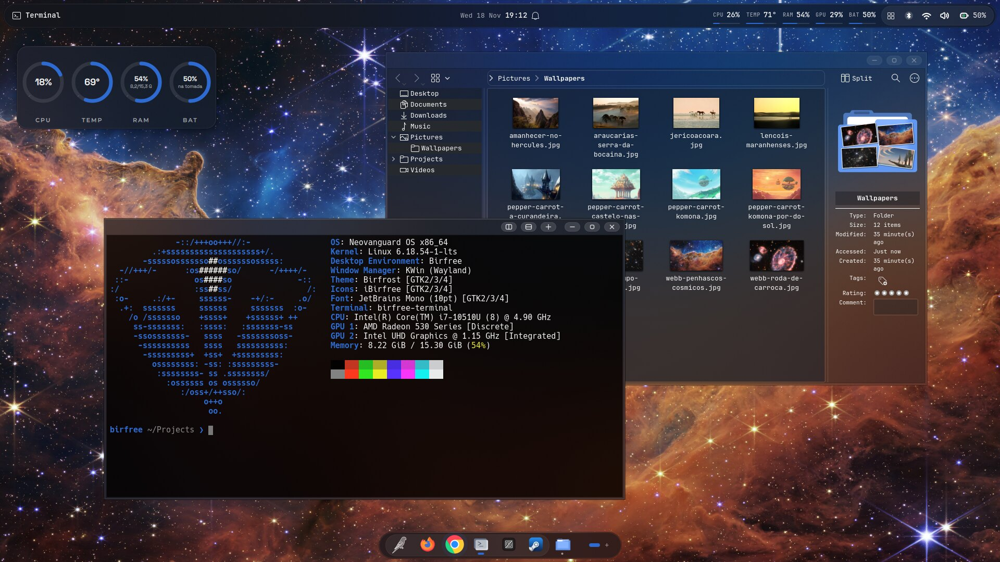

## What makes it different

### The theme follows your wallpaper

Change the wallpaper and the accent color changes with it, picked from the
image: the bar, the dock, the window glass, folder icons and widgets. No
settings to open.

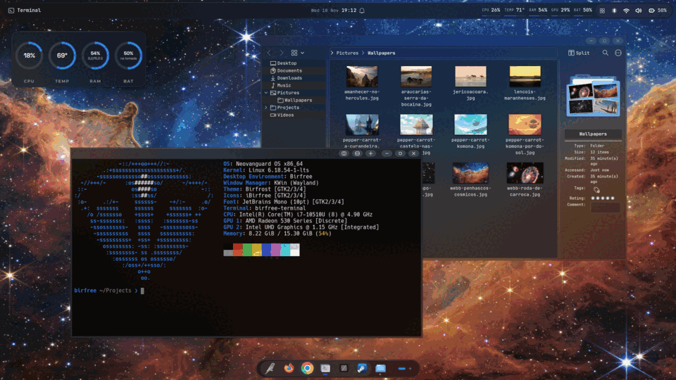

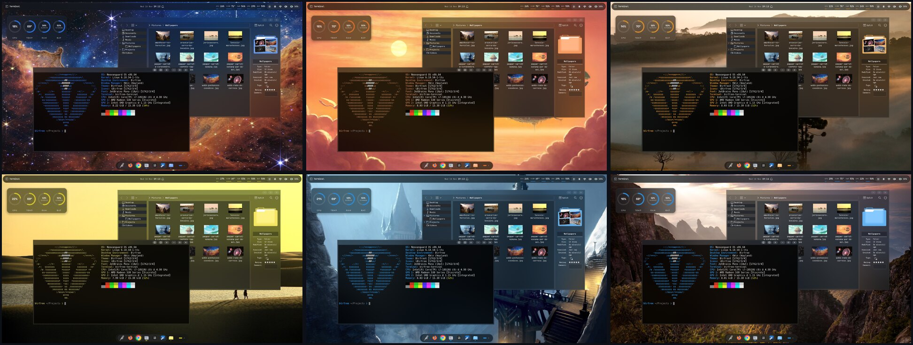

### Birfrost glass

Bar, dock, menus and windows in their own glass, with a window frame, Qt
style and GTK theme made for Birfree. You can also use just the glass on KDE
Plasma (`./instalar-birfree vidro`).

### Your dock, your way

| Floating | Integrated (a single bar) |
|---|---|
| 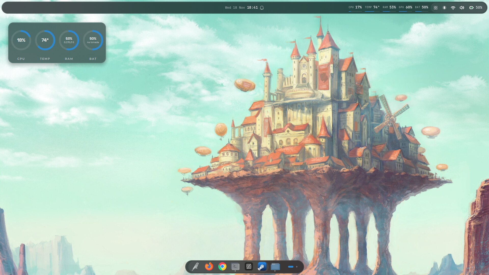 | 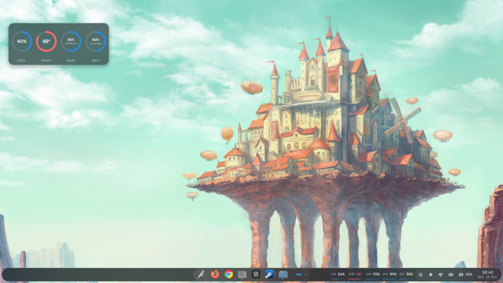 |
| **On the side** | **Customize the dock** |
| 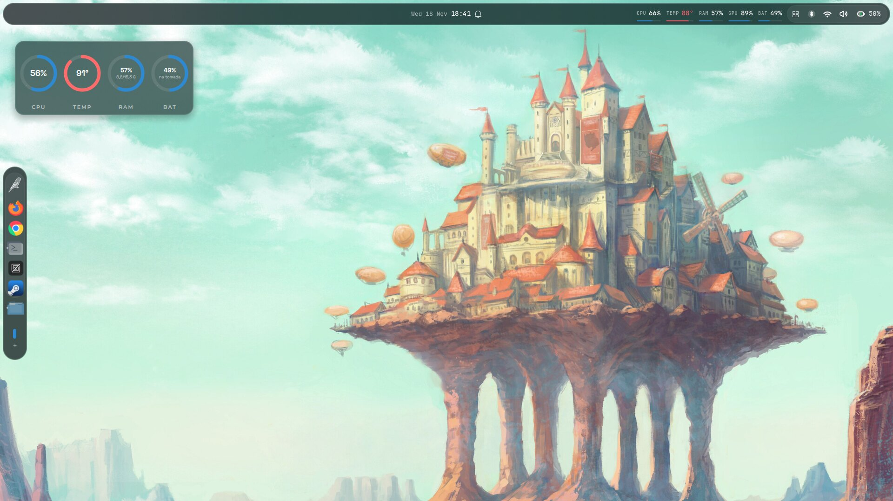 | 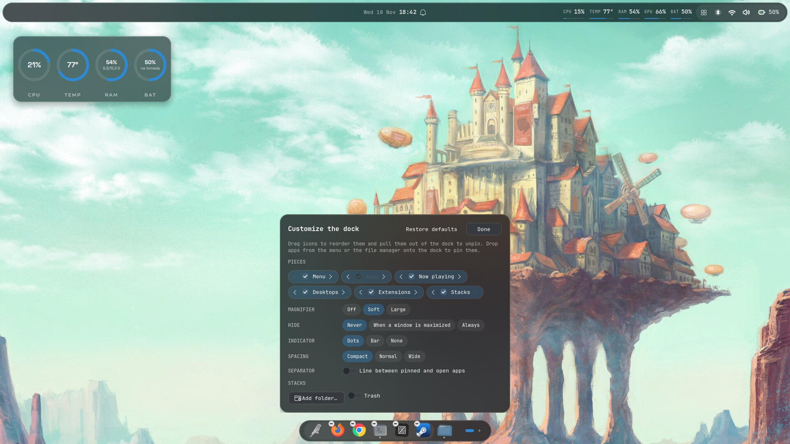 |

Magnifier (soft or large), dot or bar indicators, auto-hide, folder stacks
and the trash, all by dragging:

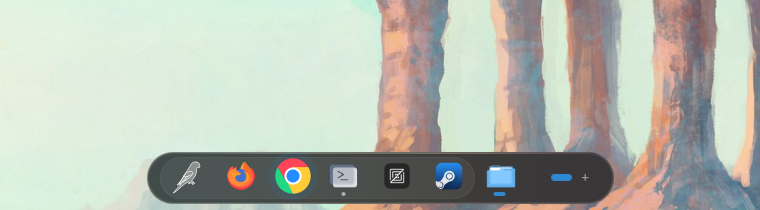

### And more

| App menu | Control center |
|---|---|
| 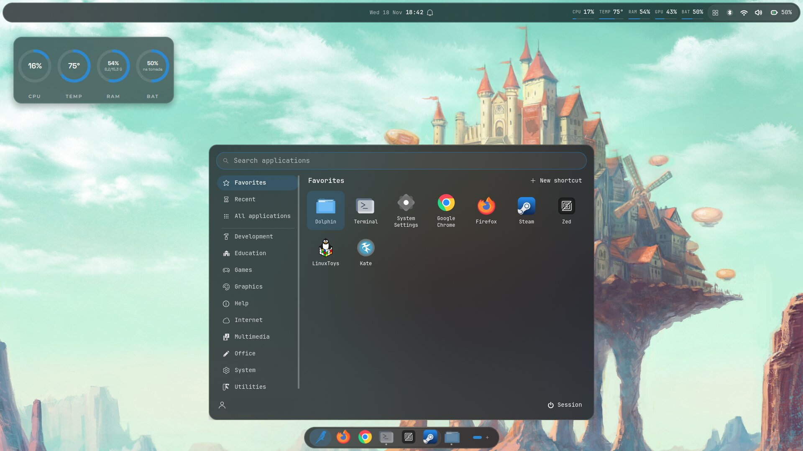 | 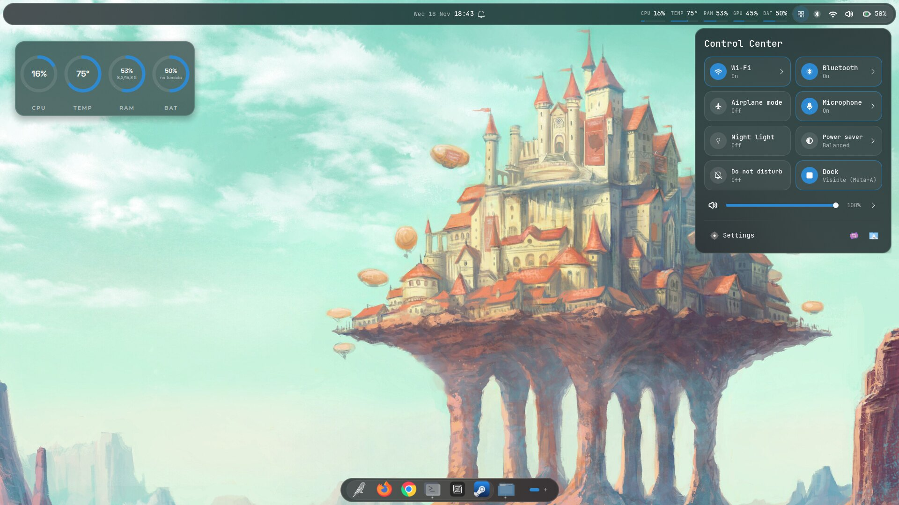 |
| **System monitor** | **Overview (Meta+W)** |
| 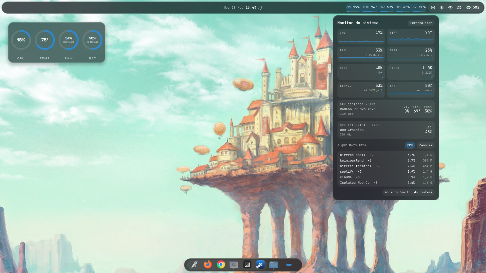 | 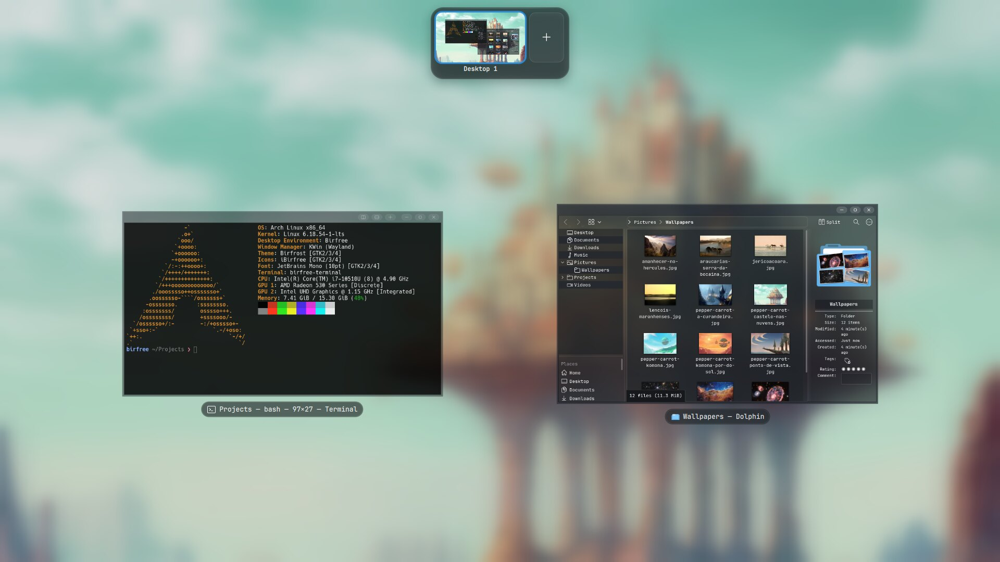 |

Wallpaper picker with Meta+Shift+click on the desktop:

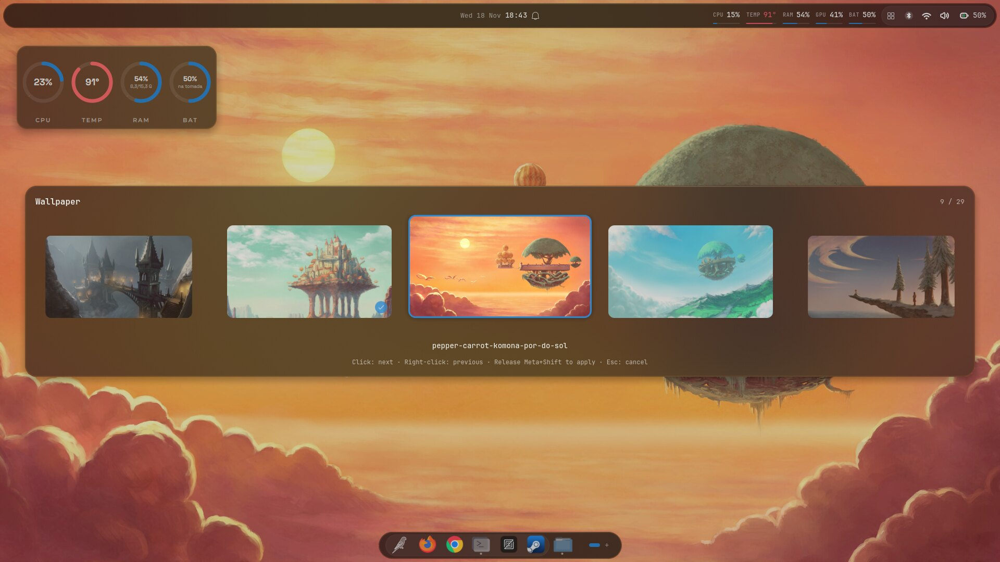

## Install

Download the latest Release, verify it and install:

```sh
curl -fLO https://github.com/NEOpisa/birfree-beta/releases/latest/download/Birfree-Beta-x86_64.tar.gz
curl -fLO https://github.com/NEOpisa/birfree-beta/releases/latest/download/SHA256SUMS
sha256sum --check SHA256SUMS
tar -xf Birfree-Beta-x86_64.tar.gz
cd Birfree-Beta-x86_64
./instalar-birfree
```

Then log out and log in to **Birfree**.

### Just one part (also on regular KDE Plasma)

The same installer ships standalone pieces, without the whole desktop:

```sh
./instalar-birfree vidro      # Birfrost glass on Plasma: frame, style, colors, cursor and GTK
./instalar-birfree dock       # the Birfree dock inside Plasma
./instalar-birfree monitor    # the system monitor (Plasma widget)
./instalar-birfree icones     # Birfree Icons
./instalar-birfree terminal   # Birfree Terminal
./instalar-birfree dock monitor   # several at once
./instalar-birfree lista      # what is installed and what the archive contains
```

`./instalar-birfree remover vidro` (or `dock`, `monitor`...) removes only that
part; the glass goes back to the look Plasma had before.

## Update

```sh
curl -fLO https://raw.githubusercontent.com/NEOpisa/birfree-beta/main/atualizar-birfree
chmod +x atualizar-birfree
./atualizar-birfree
```

It also works if you have one of the old tests (1.0 test 6.x): the beta
installs over them.

## What is in the archive

The packages `birfree` (the desktop), `birfree-vidro`, `birfree-dock`,
`birfree-sysmon`, `birfree-icons` and `birfree-terminal`, the installers,
`VERSOES.txt` (versions and the KDE/Qt stack used to build), `SHA256SUMS` and
the sources in `fontes/Birfree-fontes.tar.gz` (GPL-3.0-or-later).

The installer checks integrity and the KWin/Qt version; if your system is on
a different one, it updates the system once first. After that, `pacman -Syu`
does not update KDE or Qt (`/etc/pacman.d/birfree-congelar.conf`).

## Requirements

- Arch Linux x86_64 (or a pacman-based derivative), with sudo.
- A graphics card with working Wayland (Birfree is Wayland only; X11 apps run
  through XWayland).
- SDDM as the login screen (the installer applies the Birfree theme to it).

## Birfree and KDE Plasma side by side

You can have both. `./instalar-birfree` with no option installs Birfree on top
of what you have and keeps Plasma: on the login screen, pick **Birfree** or
**Plasma** from the session list.

- Birfree uses KDE pieces (KWin, System Settings, Dolphin...); they keep
  working for Plasma.
- The Birfree look (decoration, icons, cursor, GTK theme, colors) applies only
  in the Birfree session. When you log in to Plasma it comes back with the look
  it had; whatever you change inside Plasma stays.
- These apply to both: the login screen theme (SDDM), dark mode in browsers
  (Firefox with Dark Reader, dark Chrome/Chromium/Brave) and the KDE/Qt lock on
  `pacman -Syu` (Plasma stays on the same KDE version Birfree uses).
- `./instalar-birfree --migrar` is different: it leaves the machine with
  **only** Birfree and removes Plasma (`--desfazer` brings it back).

## System monitor

On the bar and on the dock at the same time, each with its own measures, order
and style (numbers, bars or rings): CPU, temperature, memory, swap, GPU (AMD,
Intel and NVIDIA), GPU temperature and memory, network, disk, space and
battery. Clicking opens a panel with graphs and the heaviest programs. Choose
in **Settings › Birfree › System monitor** or from the terminal:

```sh
birfree-sysmon dock sim                      # also on the dock
birfree-sysmon mostrar barra cpu,gpu,ram     # what shows on the bar
birfree-sysmon estilo dock aneis             # numeros | barrinhas | aneis
```

The same widget works on Plasma: **Add widgets › System monitor (Birfree)**,
on the desktop or in a panel.

## Customize the dock and the bar

Right-click the dock › **Customize the dock**: the icons wiggle; drag to
reorder, pull out to remove, drop apps from the menu or Dolphin to pin them
and folders to make stacks (the trash too). Magnifier, auto-hide, indicators,
spacing and pieces in the same panel.

Right-click the bar › **Customize the bar**: pieces on the left, center and
right, clock (24 h, seconds, date), style (floating or attached, corners,
solid or transparent glass) and which tray icons show. Both also in
**Settings › Birfree › Bar and dock**.

## Uninstall

Log in to Plasma and run, in the folder of the downloaded archive:

```sh
./instalar-birfree --remover
```

It removes the Birfree packages (all parts), restores the Plasma look, undoes
the KDE/Qt lock on `pacman -Syu` and the previous login screen. Your settings
in `~/.config/birfree*` stay (delete them by hand if you want).

## How Birfree is made

We use artificial intelligence to audit the code, write the documentation and
provide code insights.

The wallpapers in the screenshots ship with Birfree (Pepper&Carrot, the James
Webb telescope and photos of Brazil); the credits for each one are in
`/usr/share/birfree/wallpapers/CREDITOS.md` after installing.
