# Birfree Beta

[English](README.md) · **Português**

> [!CAUTION]
> **Não baixe nem instale o Birfree a partir deste repositório.** Ele está aqui
> para mostrar o projeto, não para uso geral. O Birfree só funciona numa
> **versão exata do sistema**: KWin/Plasma **6.7.5** e Qt **6.11.2** (KDE e Qt
> de 01/10/2026, lista completa em [`VERSOES.txt`](VERSOES.txt)). O Arch de hoje
> já está em versões mais novas (Plasma 6.8, Qt 6.12), e nelas o Birfree
> **não abre, pode travar a entrada da sessão e deixar o sistema sem área de
> trabalho**.
>
> Para usar, você teria que **travar o sistema** nessas versões: segurar o KDE
> e o Qt no pacman (`IgnorePkg`/`/etc/pacman.d/birfree-congelar.conf`) e nunca
> deixar um `pacman -Syu` atualizá-los, abrindo mão das atualizações deles,
> inclusive as de segurança. Se a trava falhar ou for tirada, o Birfree quebra
> na próxima atualização. Se mesmo assim você instalar, é **por sua conta e
> risco** e sem suporte.

> [!WARNING]
> **Isto é um beta.** O Birfree ainda está em desenvolvimento e pode ter
> defeitos, inclusive na entrada da sessão. **Instale por sua conta e risco**:
> faça backup do que importa antes e tenha como voltar ao Plasma (veja
> [Remover](#remover)).

O Birfree é a área de trabalho da Neovanguard, **pensada para o
[Neovanguard OS](https://nvgsec.com)** (em breve). É uma área de trabalho própria,
**independente do KDE Plasma**, com pacotes próprios. Este beta roda em Arch Linux x86_64
(Wayland), com pacotes prontos: nada é compilado no seu computador. Sendo feito em Rust (veja
[Feito em Rust](#feito-em-rust)).

**Versão atual: Birfree 0.6 Beta**, ainda incompleta. A 1.0 sai quando não houver
defeito conhecido.

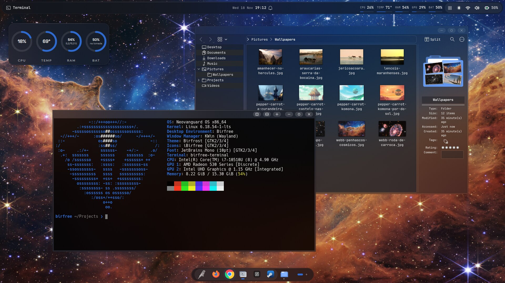

## O que ele tem de diferente

### O tema segue o papel de parede

Troque o papel de parede e a cor de destaque muda junto, tirada da imagem: a
barra, a dock, o vidro das janelas, os ícones das pastas e os widgets. Sem
abrir configuração nenhuma.

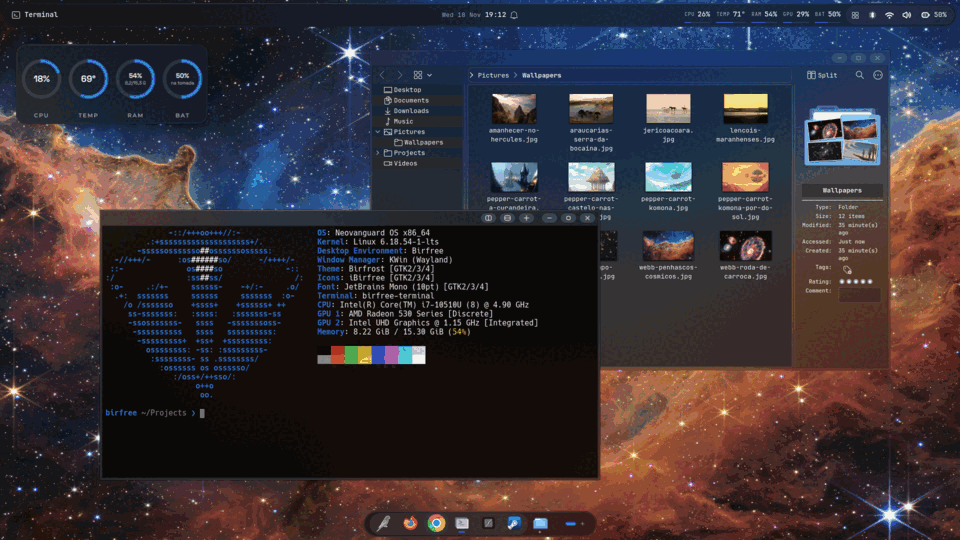

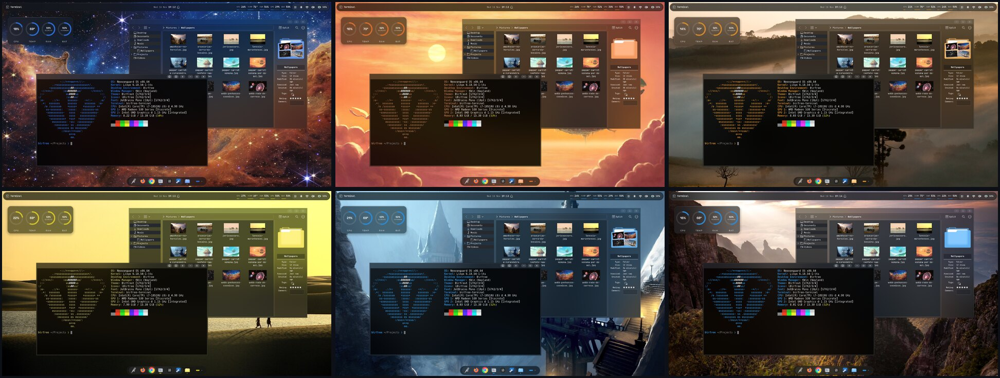

### Vidro Birfrost

Barra, dock, menus e janelas num vidro próprio, com moldura, estilo Qt e tema
GTK feitos para o Birfree. Também dá para usar só o vidro no KDE Plasma
(`./instalar-birfree vidro`).

### A dock do seu jeito

| Flutuante | Integrada (uma barra só) |
|---|---|
| 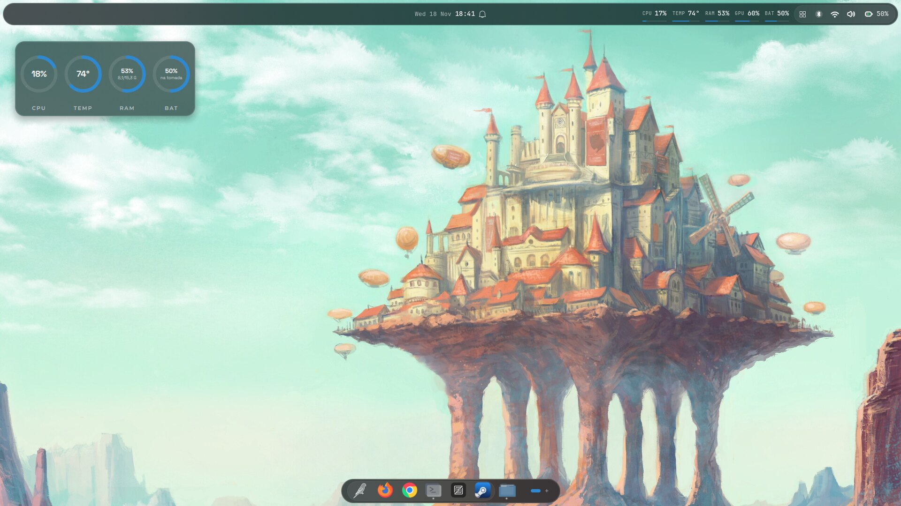 | 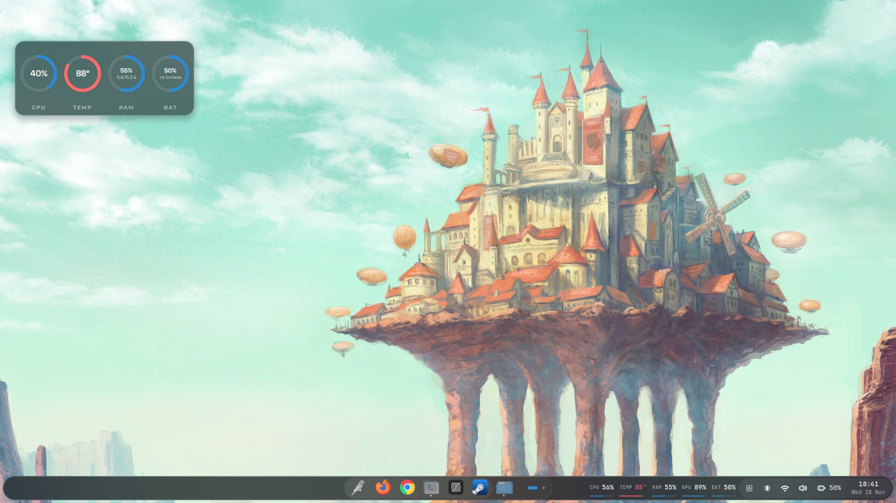 |
| **Na lateral** | **Personalizar a dock** |
| 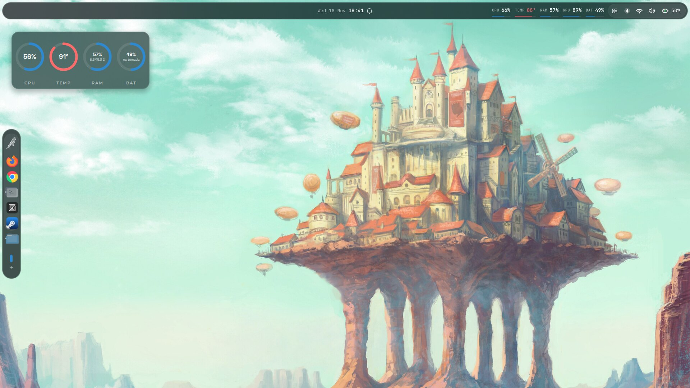 | 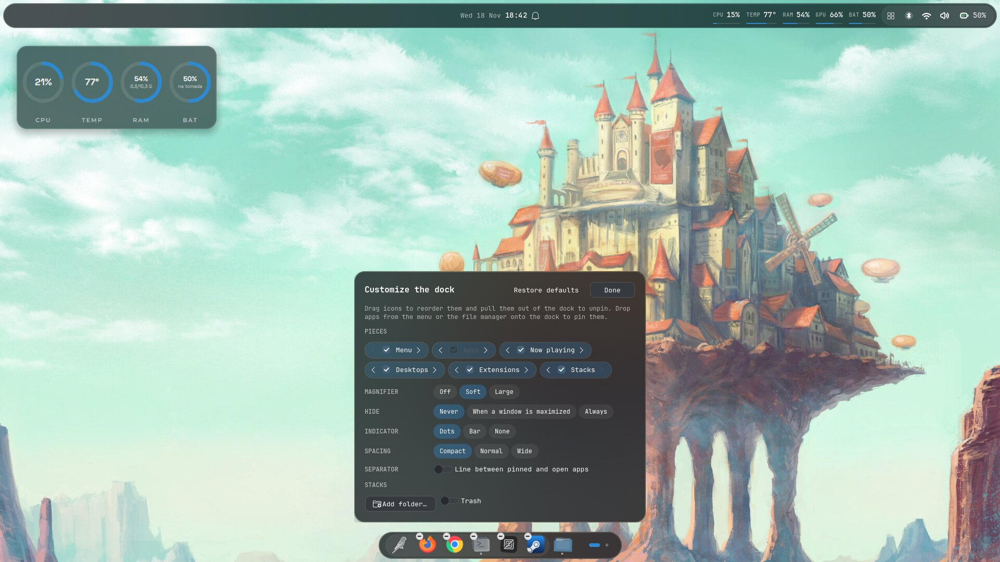 |

Lupa (suave ou grande), indicadores em pontos ou em barra, esconder sozinha,
pilhas de pastas e a lixeira, tudo arrastando:

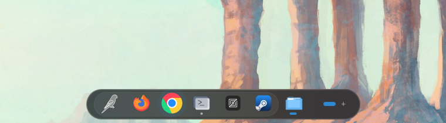

### E mais

| Menu de aplicativos | Central de controle |
|---|---|
| 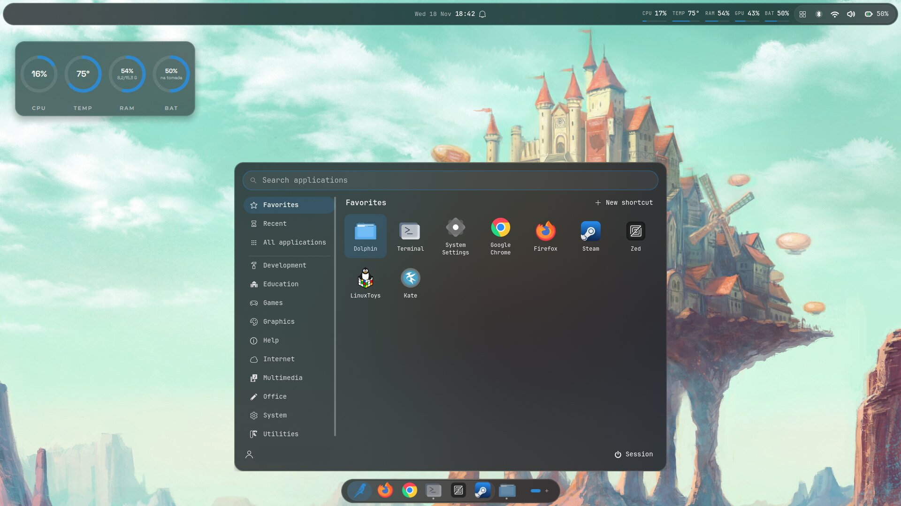 | 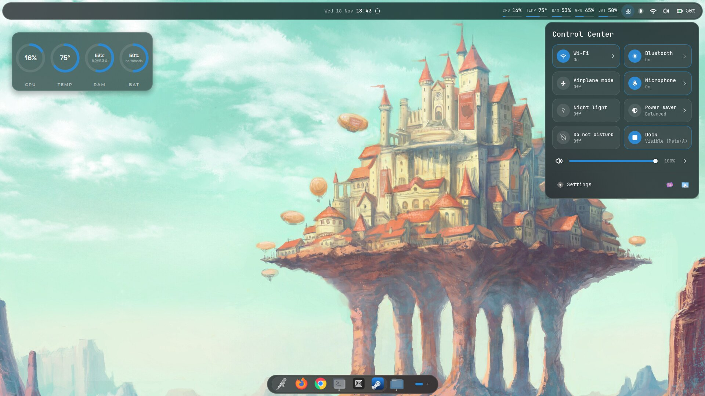 |
| **Monitor do sistema** | **Visão geral (Meta+W)** |
| 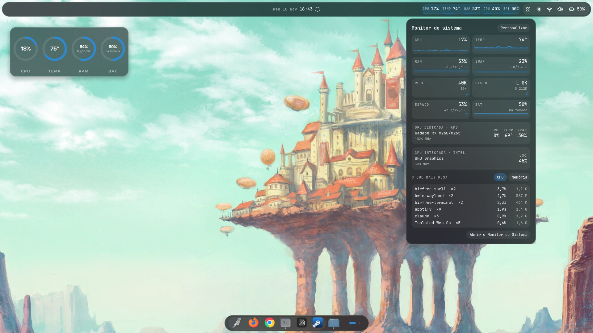 | 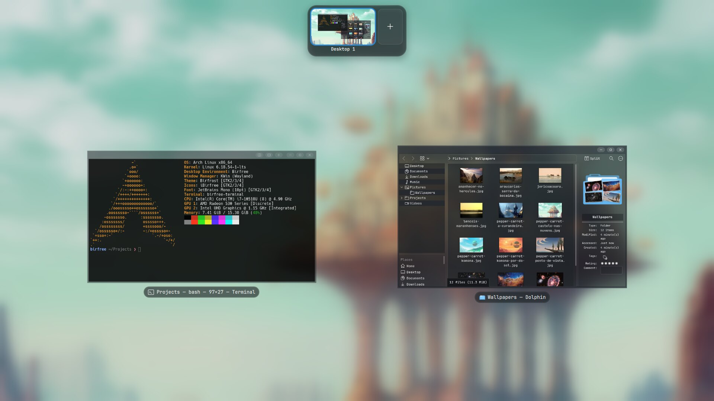 |

Seletor de papel de parede com Meta+Shift+clique na área de trabalho:

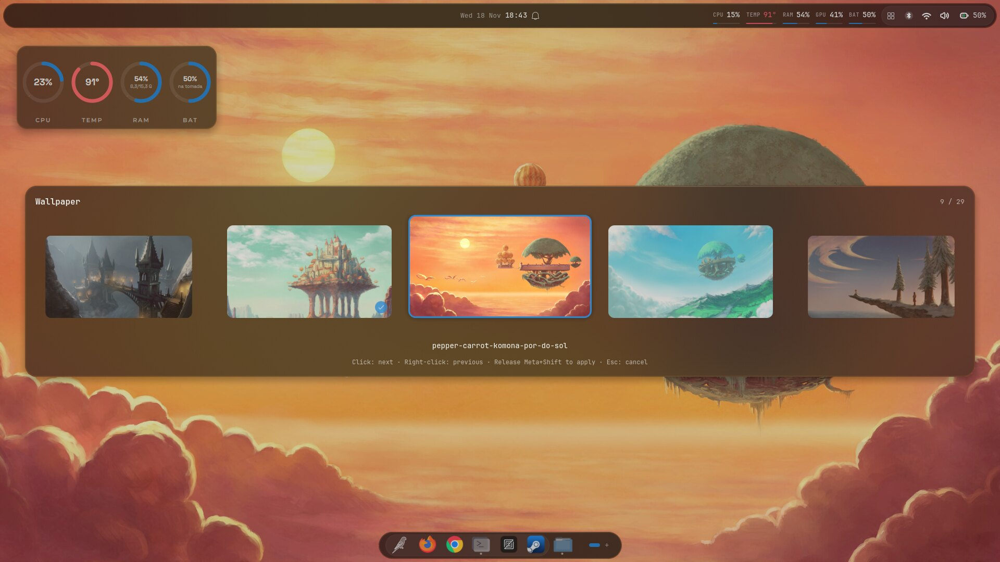

## Instalar

> [!IMPORTANT]
> Leia o [aviso do começo](#birfree-beta) antes: só instale num sistema
> travado no KDE 6.7.5 / Qt 6.11.2.

Baixe a Release mais nova, confira e instale:

```sh
curl -fLO https://github.com/NEOpisa/birfree-beta/releases/latest/download/Birfree-Beta-x86_64.tar.gz
curl -fLO https://github.com/NEOpisa/birfree-beta/releases/latest/download/SHA256SUMS
sha256sum --check SHA256SUMS
tar -xf Birfree-Beta-x86_64.tar.gz
cd Birfree-Beta-x86_64
./instalar-birfree
```

Depois, saia da sessão e entre em **Birfree**. O **Birup** (menu › Birup)
vem junto: é por ele que as próximas versões chegam.

### Só o Birup

O Birup instala e atualiza o Birfree e os apps da Neovanguard, e se atualiza
sozinho. Para instalar só ele, sem baixar o Birfree, e escolher pela janela:

```sh
curl -fsSL https://github.com/NEOpisa/birfree-beta/releases/latest/download/instalar-birup | bash
```

Ele só instala o que tiver a assinatura do Birfree.

### Só uma parte (também no KDE Plasma comum)

O mesmo instalador traz peças avulsas, sem a área de trabalho inteira:

```sh
./instalar-birfree vidro      # o vidro Birfrost no Plasma: moldura, estilo, cores, cursor e GTK
./instalar-birfree dock       # a dock do Birfree dentro do Plasma
./instalar-birfree monitor    # o monitor do sistema (widget do Plasma)
./instalar-birfree icones     # Birfree Icons
./instalar-birfree terminal   # Terminal Birfree
./instalar-birfree dock monitor   # várias de uma vez
./instalar-birfree lista      # o que está instalado e o que vem no arquivo
```

`./instalar-birfree remover vidro` (ou `dock`, `monitor`...) tira só aquela
parte; o vidro volta para a aparência que o Plasma tinha antes.

## Atualizar

A partir da **0.6 Beta (0.6.7.0)**, pelo **Birup**: ele avisa quando sai
versão nova (no login e a cada 6 horas) e atualiza com um clique.

Numa versão anterior, que ainda não tem o Birup, o comando de sempre (ele já
traz o Birup):

```sh
curl -fLO https://raw.githubusercontent.com/NEOpisa/birfree-beta/main/atualizar-birfree
chmod +x atualizar-birfree
./atualizar-birfree
```

Funciona também para quem tem um dos testes antigos (1.0 teste 6.x).

## O que vem no arquivo

Os pacotes `birfree` (a área de trabalho), `birfree-compositor` (o compositor
do Birfree), `birfree-vidro`, `birfree-dock`, `birfree-sysmon`, `birfree-icons`
e `birfree-terminal`, o Birup, os instaladores,
`VERSOES.txt` (versões e a pilha KDE/Qt usada na compilação), `SHA256SUMS` e
os fontes em `fontes/Birfree-fontes.tar.gz` (GPL-3.0-or-later).

O instalador confere a integridade e a versão do KWin/Qt; se o sistema estiver
em outra, ele atualiza o sistema uma vez antes. O `pacman -Syu` depois disso
não atualiza o KDE nem o Qt (`/etc/pacman.d/birfree-congelar.conf`).

## Requisitos

- Arch Linux x86_64 (ou derivado com pacman), com sudo.
- **KDE/Plasma 6.7.5 e Qt 6.11.2 exatamente**, travados no pacman (veja o
  aviso do começo). Em versões mais novas o Birfree não funciona.
- Placa de vídeo com Wayland funcionando (o Birfree é só Wayland; apps X11
  abrem pelo XWayland).
- SDDM como tela de entrada (o instalador põe o tema do Birfree nela).

## Independente do KDE Plasma

O Birfree é uma área de trabalho própria, com pacotes próprios (`birfree`,
`birfree-vidro`, `birfree-dock`, `birfree-sysmon`, `birfree-icons`,
`birfree-terminal`). Ele não precisa do Plasma, e ter o Plasma instalado não
atrapalha: na tela de entrada, escolha **Birfree** ou **Plasma** na lista de
sessões.

- **Saindo do KDE uma peça por vez.** Hoje o Birfree ainda usa algumas peças
  do KDE por baixo (KWin, Configurações do Sistema, Dolphin...). Cada uma é
  trocada por uma do próprio Birfree quando chegar a vez dela. A partir da
  0.6.7, o Birfree traz a própria versão do compositor, instalada à parte da
  que o Plasma usa.
- A aparência do Birfree (moldura, ícones, cursor, tema GTK, cores) vale só
  na sessão Birfree. Ao entrar no Plasma, ele volta com a aparência que tinha;
  o que você mudar dentro do Plasma fica.
- Por enquanto valem para os dois: o tema da tela de entrada (SDDM), o modo
  escuro nos navegadores (Firefox com Dark Reader, Chrome/Chromium/Brave
  escuros) e a trava do KDE/Qt no `pacman -Syu` (o Plasma fica na mesma versão
  do KDE que o Birfree usa).
- `./instalar-birfree --migrar` é diferente: deixa a máquina **só** com o
  Birfree e tira o Plasma (`--desfazer` traz de volta).

## Monitor do sistema

Na barra e na dock, ao mesmo tempo, cada uma com as medidas, a ordem e o
estilo dela (números, barrinhas ou anéis): CPU, temperatura, memória, swap,
GPU (AMD, Intel e NVIDIA), temperatura e memória da GPU, rede, disco, espaço e
bateria. O clique abre um painel com gráficos e os programas que mais pesam.
Escolha em **Configurações › Birfree › Monitor do sistema** ou pelo terminal:

```sh
birfree-sysmon dock sim                      # também na dock
birfree-sysmon mostrar barra cpu,gpu,ram     # o que aparece na barra
birfree-sysmon estilo dock aneis             # numeros | barrinhas | aneis
```

O mesmo widget funciona no Plasma: **Adicionar widgets › Monitor do sistema
(Birfree)**, na área de trabalho ou num painel.

## Personalizar a dock e a barra

Clique direito na dock › **Personalizar a dock**: os ícones tremem, arraste
para mudar a ordem, puxe para fora para tirar, solte apps do menu ou do
Dolphin para fixar e pastas para virar pilha (também a lixeira). Lupa,
esconder sozinha, indicadores, espaço e peças no mesmo painel.

Clique direito na barra › **Personalizar a barra**: peças na esquerda, no
centro e na direita, relógio (24 h, segundos, data), estilo (flutuante ou
colada, cantos, vidro sólido ou transparente) e os ícones da bandeja que
aparecem. As duas também em **Configurações › Birfree › Barra e dock**.

## Remover

Entre no Plasma e rode, na pasta do arquivo baixado:

```sh
./instalar-birfree --remover
```

Tira os pacotes do Birfree (todas as partes), devolve a aparência do Plasma, desfaz a trava do
KDE/Qt no `pacman -Syu` e a tela de entrada anterior. Suas configurações em
`~/.config/birfree*` ficam (apague à mão se quiser).

## Feito em Rust

O Birfree está sendo escrito em **Rust**, e o objetivo é que ele seja todo em
Rust. Já estão em Rust hoje: o núcleo da shell (janelas, dock, menu, bandeja,
energia, avisos, cor de destaque, via [cxx-qt](https://github.com/KDAB/cxx-qt)),
o Terminal Birfree (sobre o `alacritty_terminal`), os programas de entrada da
sessão, a parte de trás das Configurações, o monitor do sistema, o recolorido
dos ícones e a ponte do Discord. A interface ainda é Qt/QML sobre o KWin, e o
C++ que sobrou passa para Rust um pouco a cada patch.

## Como o Birfree é feito

Usamos inteligência artificial para auditar o código, escrever a
documentação e trazer insights sobre o código.

Os papéis de parede das fotos vêm com o Birfree (Pepper&Carrot, telescópio
James Webb e fotos do Brasil); os créditos de cada um ficam em
`/usr/share/birfree/wallpapers/CREDITOS.md` depois de instalar.
